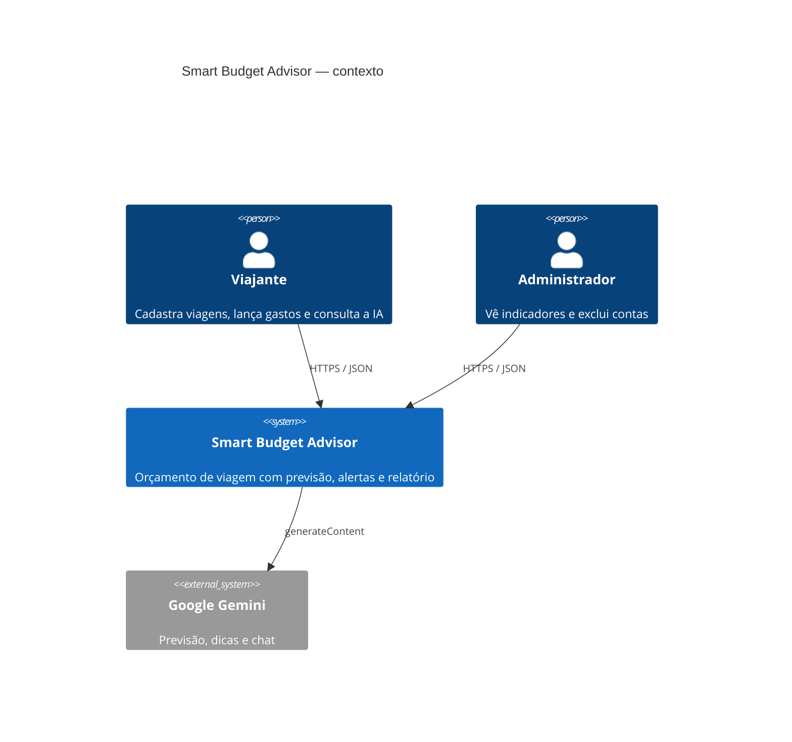
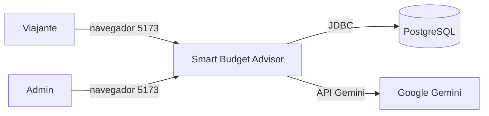
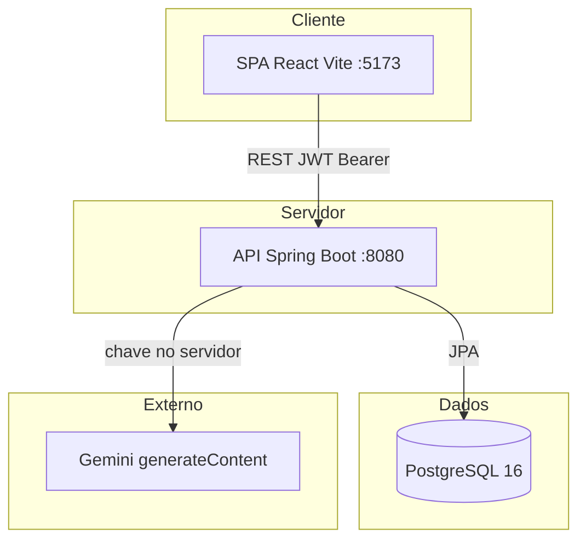
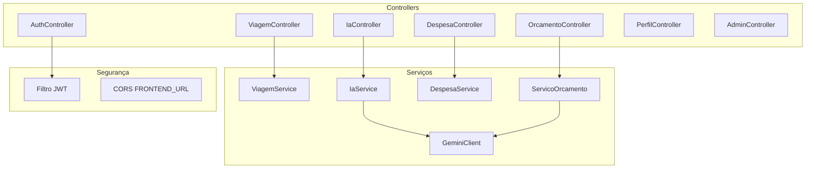
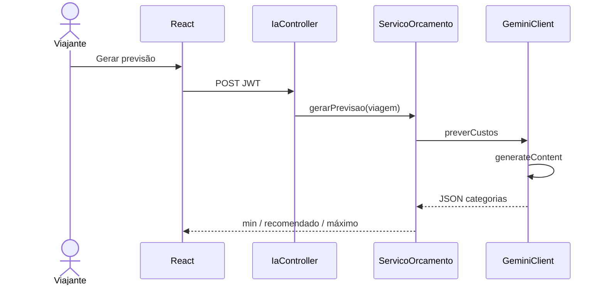

# Modelo C4 — Smart Budget Advisor

Figuras para o item 12 da Unidade II. Exportar cada diagrama (Mermaid no GitHub, [mermaid.live](https://mermaid.live) ou VS Code) e colar no Overleaf.

## Nível 1 — Contexto

O viajante usa o sistema para planejar orçamento de viagem. O admin gerencia contas. A API fala com o banco e com o Gemini (sem enviar nome ou e-mail).

Se o renderer C4 falhar, use o equivalente:

## Nível 2 — Contêineres

## Nível 3 — Componentes da API

## Nível 4 — Código (previsão)

Fluxo resumido de `POST /api/viagens/{id}/previsao`: o controller autentica o viajante, o serviço monta o contexto da viagem (sem PII) e o `GeminiClient` chama `generateContent`. Timeout configurável; até 3 tentativas se o Google devolver 503.

Pacotes Java: `controller`, `service`, `service.ia`, `model`, `dto`, `seguranca`.
